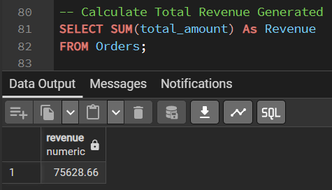
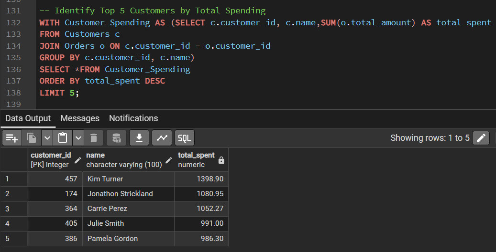
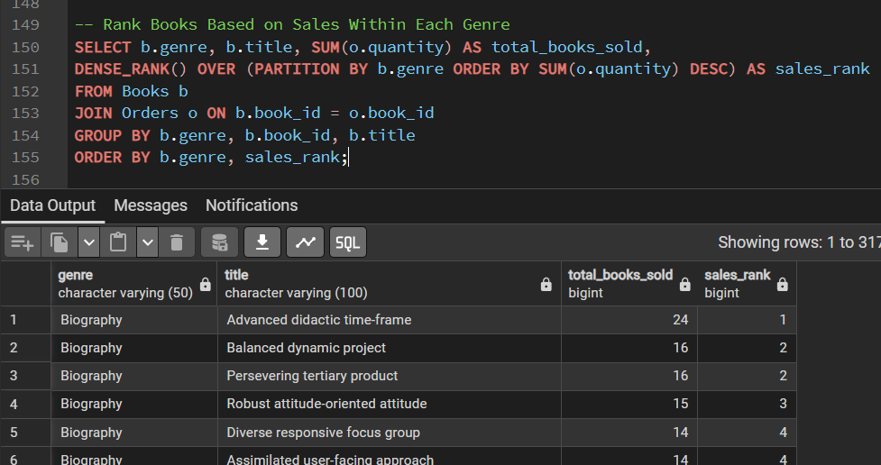
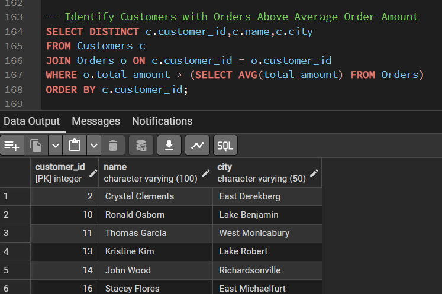
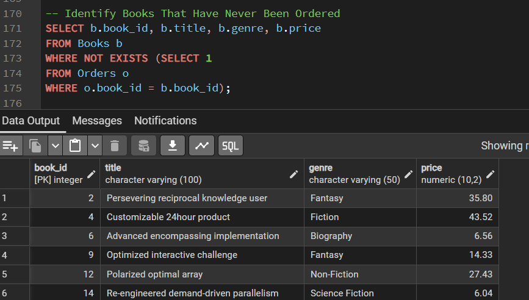

# Online Bookstore SQL Analytics

## Project Overview

This project analyzes an online bookstore database using PostgreSQL to understand sales performance, customer purchasing behavior, book performance, inventory status, and revenue trends.

The analysis uses SQL queries to extract meaningful business insights from Books, Customers, and Orders tables.

## SQL Concepts Used

- SELECT Statements
- WHERE Clause
- GROUP BY
- ORDER BY
- Aggregate Functions
- JOINs
- HAVING Clause
- DISTINCT
- COALESCE
- LIMIT
- Common Table Expressions (CTEs)
- Subqueries
- Window Functions (DENSE_RANK, ROW_NUMBER)
- EXISTS and NOT EXISTS
- Date Functions

## Key Analysis Performed

- Total Revenue Analysis
- Customer Spending Analysis
- Genre-wise Revenue Analysis
- Inventory Analysis
- Most Frequently Ordered Books
- Author-wise Book Sales
- City-wise Revenue Analysis
- High-Value Order Analysis
- Top 5 Customers by Total Spending
- Book Sales Ranking Within Each Genre
- Customer Order Sequence Analysis
- Above-Average Order Analysis
- Identifying Books That Have Never Been Ordered

## Sample Query Outputs

### 1. Total Revenue Analysis

### 2. Top 5 Customers by Total Spending (CTE)

### 3. Book Sales Ranking Within Each Genre (DENSE_RANK)

### 4. Customers with Orders Above Average Order Amount

### 5. Books That Have Never Been Ordered

## Tools Used

- PostgreSQL
- pgAdmin
- SQL
